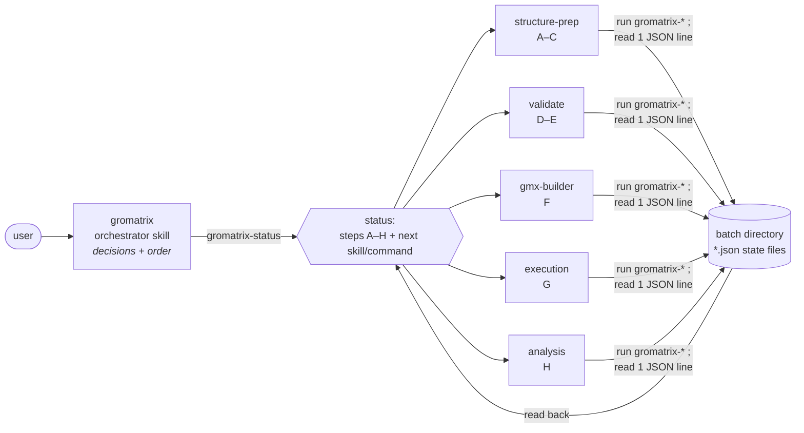
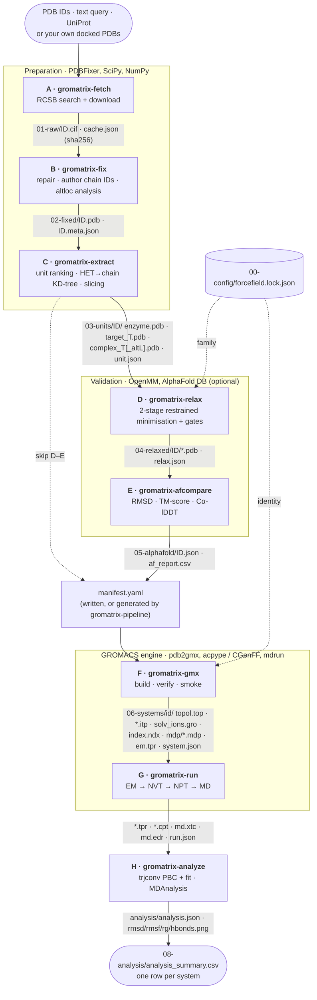

# gromatrix

<p>
  <a href="https://github.com/markbujehein/gromatrix/actions/workflows/ci.yml"></a>
  <a href="https://codecov.io/gh/markbujehein/gromatrix"></a>
  <a href="LICENSE"></a>
  <a href="pixi.toml"></a>
</p>

**From PDB IDs to a comparable set of GROMACS simulations, with one forcefield and with every
step checked.**

gromatrix builds and runs a molecular-dynamics **simulation matrix**: every receptor alone, every
target alone, and every receptor + target complex. Targets can be drugs, cofactors or other
proteins. It works from any PDB/mmCIF entry or docked pose: single chains, hetero-oligomers,
multi-copy asymmetric units, and symmetry-generated assemblies. Eight steps (A–H) take a structure
from download to trajectory analysis. Each step is one command with a one-line JSON result, and a
set of Claude agent skills can drive them.

It is also an **open demonstration of AI-assisted scientific software engineering**: a human
domain lead directing Claude as the primary developer. How that split worked, including where
human judgement overruled the AI, is the [second section](#the-human-pilot-and-the-ai-engine).

> **Status: alpha (0.x).** Steps A–E are exercised on an 82-structure benchmark (partial run,
> see [Validation](#validation)). Steps F–H are covered by tests against simulated GROMACS
> output but **have not yet run against real GROMACS**. The CLI and file formats may still
> change between minor versions.

| Step | Command | What it does |
|---|---|---|
| lock | `gromatrix-gmx lock` | fixes one forcefield for the whole batch (AMBER or CHARMM family) |
| A | `gromatrix-fetch` | RCSB download by ID, full-text or UniProt search; sha256-verified cache |
| B | `gromatrix-fix` | PDBFixer repair, author chain IDs, gap policy, alternate-conformer analysis |
| C | `gromatrix-extract` | picks the biological unit that holds the targets; slices enzyme / target / complex |
| D | `gromatrix-relax` | restrained OpenMM minimisation with failure labels (explosion, pocket collapse, …) |
| E | `gromatrix-afcompare` | per-chain comparison with AlphaFold DB: RMSD, TM-score, Cα-lDDT |
| F | `gromatrix-gmx build / verify / smoke` | topologies, ligand parameters, box, solvent, ions, gated `em.tpr` |
| G | `gromatrix-run` | EM → NVT → NPT → production with checkpoint resume; local, background or Slurm |
| H | `gromatrix-analyze` | PBC removal, RMSD, RMSF, Rg, H-bond persistence, plots, matrix summary |
| A–H | `gromatrix-pipeline` | all of the above from one manifest, with dry run and fail-fast |

## The human pilot and the AI engine

| Human (maintainer) | AI (Claude, via Claude Code) |
|---|---|
| **Domain architect and biophysics lead.** Defined the matrix concept and the forcefield rules (no mixing within a batch; acpype for AMBER, CGenFF for CHARMM), and named the hard structural cases. | **Primary developer.** Wrote all of `src/` (~6,700 lines), the CI workflows and the release tooling. |
| **Pipeline strategist.** Set the step order and the scope of each step, and chose the PXR/CAR benchmark. | **Test author.** Wrote 82 tests: an offline end-to-end run on 1XVP, a fake `gmx` that reproduces GROMACS checkpoint and `-maxh` behaviour, and a synthetic trajectory with known answers. |
| **Quality assurer.** Required independent review agents, pixi CI and honest reporting of what is untested; holds the version at 0.x; owns merges and tags. | **Skill integrator.** Built six agent skills and the `gromatrix-status` hand-off; ran the benchmark and two rounds of review agents. |

**The agentic control plane.** An agent running an eight-step pipeline typically fails by
forgetting state, or by drowning in documentation for steps it isn't running. gromatrix is built
so neither can happen:



- **State lives on disk.** Every step writes JSON state files into the batch directory.
  `gromatrix-status` reads only those files and names the `next` skill and command, so any session
  can resume any batch.
- **Progressive disclosure.** The orchestrator holds only the hard-to-undo decisions. Each stage
  skill documents only its own commands, with details in `references/`. A test fails if a stage
  skill runs another stage's commands.
- **Gates live in code, not prompts.** The forcefield lock, parameter caches and physical
  checks are enforced by the commands, so an agent can't argue its way past them.

**Where human domain judgement changed the design** (full account, with commits:
[docs/ai-collaboration.md](docs/ai-collaboration.md)):

1. **"Randomly picking one conformer is biophysically unsound."**
   - The first step-C code simply kept conformer A of the 1XVP ligand CITCO. The human rejected
     that, and asked whether averaged coordinates could be used instead.
   - The investigation found that A and B are a ring flip, at 0.38 Å after symmetry matching.
     Averaging would have collapsed aromatic bonds to 0.70 Å.
   - The result is a rule: **never average; branch the matrix only for genuinely distinct
     poses.**
2. **The 1XVP problem.**
   - Before any extraction code existed, the human specified the trap: the drug is bound in only
     one of two heterodimers, so naively taking "the first dimer" loses the target.
   - The result is **completeness-first unit selection**, which the benchmark later hardened
     against mislabelled ligands.
3. **"Mixing forcefields within a comparison matrix is strictly forbidden."**
   - The result is a batch-wide **forcefield lock**, stamped on every artefact and re-checked by
     `verify`, with one parameter template per ligand per batch.

Not every catch was human: the AI's own review agents found, for example, that the OpenMM chain-ID
remap could swap chains in polymer-only mmCIFs. Not every human correction was biophysics either:
the human also caught over-fitting to the 1XVP benchmark, a package-naming inconsistency, and a
premature 1.0 version.

## System architecture

Data flow through steps A–H. Solid arrows carry files. The forcefield lock is read by every
family-dependent step.



The engineering reference covers the step contracts, code layout, batch-directory layout and
per-step design decisions: [docs/architecture.md](docs/architecture.md).

## Biophysical rules and edge cases

**Stoichiometric unit selection** (`extract.py`):
- **Candidates.** Every deposited assembly (with its symmetry operators) and every stoichiometric
  sub-unit of the asymmetric unit are candidates. A stoichiometric sub-unit has entity copy
  numbers divided by their GCD, and its chains must be connected by real interfaces.
- **Ligand assignment.** Each ligand or cofactor is assigned to the chain it physically contacts
  most, using a SciPy `cKDTree` within 4.5 Å, not the chain label it was deposited with.
- **Ranking is completeness-first.** A candidate holding every declared target always beats one
  that doesn't. Ties go to author-defined assemblies, then fewer chains, then larger interfaces,
  then fewer unmodelled residues, then lower B-factors. So 1XVP yields chains C, D, G, H: the only
  heterodimer that carries both CITCO and the fatty acid.

**Alternate conformers** (`altlocs.py`, `extract.py`):
- **Primary pose:** the highest occupancy wins.
- **Comparison:** conformers are compared by RMSD after Hungarian matching of equivalent atoms,
  so a ring flip doesn't count as a new pose.
- **Branching:**
  - A conformer at ≥ 0.5 Å symmetry-corrected RMSD from the primary branches the matrix into
    `complex_<T>_altA/B/…`.
  - The branch must touch the unit and must not clash below 1.5 Å.
  - A conformer whose bond lengths disagree by more than 0.2 Å is treated as a broken model.
- **Coordinates are never averaged.**

**Forcefield and topology integrity** (`forcefields.py`, `ligands.py`, `topology.py`, `checks.py`):
- **Forcefield lock.** One lock per batch:
  - AMBER family (amber99sb-ildn default, amber14sb, amber19sb): acpype/GAFF2/AM1-BCC.
  - CHARMM36m: CGenFF, with a hard stop above penalty 50.
- **Ligand template.** Each ligand is parameterised once per batch. Every pose is mapped onto
  that template's atom order, and a mismatched itp order is refused.
- **Parameter conflicts.** Two ligands defining the same bonded parameter differently stop the
  build.
- **Atom walk.** The topology is walked against the coordinates atom by atom.
- **Charge.** The net charge must be an integer before `genion` and zero after it.
- **Zero-warning gate.** The final `grompp` must pass with zero warnings.

**Crystallographic repair** (`fix.py`, `pdbio.py`):
- **Chain IDs.** Chains are mapped back to author IDs using OpenMM's own label/auth rule.
- **Missing atoms and loops.** Missing heavy atoms are built, and loops up to 8 residues
  (`--max-loop`) are modelled.
- **Long gaps.** Longer gaps stay open and are written with `TER`. A `TER` is also written
  wherever a C(i)–N(i+1) distance exceeds 2.0 Å, so no tool bonds across a real break.
- **Hydrogens, waters, additives.** All hydrogens are removed; each forcefield's own tools rebuild
  them. Waters and crystallisation additives are stripped by policy (`--waters`,
  `--keep-additives`).

**MD execution and analysis** (`run.py`, `analyze.py`):
- **Gates before production.** Equilibration must pass: EM must converge, and NVT/NPT must have
  zero LINCS warnings across all log segments.
- **Resume.** Checkpoint resume never mistakes a `-maxh` stop for completion.
- **Ligand RMSD.** It is measured in the protein's frame, so pose drift is visible.
- **Atom selection.** Atoms come from named index groups, not residue-name guesses.

## Validation

Two datasets **stress-test** the algorithms; neither is a special case in the code:

- **1XVP.** A multi-copy RXRα/CAR heterodimer with uneven ligand binding and alternate
  conformers. It runs offline in every CI build as an end-to-end regression.
- **82 human PXR/CAR crystal structures.** Every X-ray entry containing human PXR (O75469) or CAR
  (Q14994).

Full report: [benchmarks/pxr_car_validation.md](benchmarks/pxr_car_validation.md). The run is
**partial**: B, C and E on the first 16 entries, D not yet on the panel, F–H not part of this
benchmark.

| Step | Ran on | Succeeded | Time per entry (4-core CPU) |
|---|---|---|---|
| A fetch | 82 | 82 | – (cache rerun: 100 % `cached`) |
| B fix | 16 | 16 | median 13 s (max 133 s, loop building) |
| C extract | 16 | 16, all resolved to author-defined assemblies | 0.27 s |
| D relax | 1XVP regression only | 1XVP: no failure labels, heavy-atom RMSD 1.06–1.12 Å | 10–13 s per file |
| E AlphaFold | 16 entries / 25 scored chains | 25 / 25, none flagged | 1.8 s (1.2 s cached) |

| Agreement with AlphaFold (25 chains) | Mean | Range |
|---|---|---|
| TM-score | **0.949** | 0.896–0.991 |
| Cα-lDDT | **0.938** | 0.874–0.977 |
| Cα RMSD, confident core (pLDDT ≥ 70) | **0.99 Å** | 0.58–1.43 Å |
| Cα RMSD, all aligned residues | 1.80 Å | 0.59–3.85 Å |

The TM-score implementation agrees with TM-align within 0.003.

Real deposition anomalies found on the panel. The first two exposed defects, which were fixed
generically, with regression tests:

| Entry | Anomaly | Handling |
|---|---|---|
| 1XV9 | Ligand labelled chain D, but bound in chain B's pocket (121 contacts with B, 0 with D) | HET membership follows contacts; correct author assembly chosen instead of the whole 8-chain AU |
| 1XV9 | A second ligand copy, 48 Å away, deposited as "altloc B" | Branch must contact the unit; rejected as a copy, not a conformer |
| 1ILH | Three genuine SR12813 binding orientations (symmetry-corrected RMSD 4.3 and 3.8 Å from the primary) | Matrix branched into `complex_SRL_altA/B/C`, all clash-free |
| 1XVP | CITCO "conformers" that are a ring flip (raw 1.03 Å, symmetry-corrected 0.38 Å) | Primary pose only; averaging would have made 0.70 Å ring bonds |
| 4J5X | RXRα–SRC-1 fusion chains with two UniProt accessions | Best-covering accession chosen; TM-score 0.09 → 0.90 |
| 4S0S | No SIFTS record; engineered Adnectin binder | RCSB mapping fallback (TM 0.99); binder correctly reported as unmapped |
| 14 PXR entries | Disordered β-insert (13–32 residues missing) | Left open with `TER` (35 gaps); 15 short loops modelled; 1,241 missing atoms built |

## Quickstart (30-second verification)

Install [pixi](https://pixi.sh) (`curl -fsSL https://pixi.sh/install.sh | bash`), then:

```bash
git clone https://github.com/markbujehein/gromatrix && cd gromatrix
pixi install                 # locked conda-forge environment: OpenMM, PDBFixer, RDKit, MDAnalysis
pixi run test                # fast test suite
pixi run test-all            # full suite incl. the offline 1XVP end-to-end regression, with coverage
```

Steps lock → B → C on the bundled 1XVP structure run offline in about 5 seconds:

```bash
mkdir -p runs/demo/raw && gunzip -c tests/data/1XVP.cif.gz > runs/demo/raw/1XVP.cif
pixi run gromatrix-gmx lock --batch-dir runs/demo --forcefield amber
pixi run gromatrix-fix --batch-dir runs/demo
pixi run gromatrix-extract --batch-dir runs/demo --targets CID
pixi run gromatrix-status --batch-dir runs/demo
pixi run gromatrix-pipeline --manifest examples/pipeline.yaml --dry-run   # the A–H plan; nothing runs
```

Every command prints one JSON result line. The output of `gromatrix-extract` (paths shortened):

```json
{"ok": true, "units": [{"id": "1XVP", "selected": "assembly-2", "chains": ["C", "D", "G", "H"],
  "inventory": {"F15": 1, "CID": 1}, "runner_up": "assembly-4",
  "files": ["complex_CID.pdb", "enzyme.pdb", "target_CID.pdb", "unit.pdb"],
  "warnings": ["CID: conformers equivalent within --altloc-rmsd (symmetry-corrected); primary used"]}],
 "failed": []}
```

`gromatrix-status` then reports where the batch stands and what comes next (trimmed):

```json
{"ok": true, "forcefield": "amber99sb-ildn",
 "steps": {"A": "done", "B": "done", "C": "done", "D": "pending", "E": "pending", "F": "pending", "G": "pending", "H": "pending"},
 "next": {"skill": "gromatrix:validate", "command": "gromatrix-relax --batch-dir runs/demo", "why": "not relaxed: ['1XVP']"}}
```

Steps A and E need network access to RCSB, PDBe and AlphaFold DB. Steps F–H need GROMACS:
`pixi shell -e md` adds GROMACS, acpype and Open Babel. For a full study, start from
[`examples/pipeline.yaml`](examples/pipeline.yaml) (one command, A–H) or
[`examples/manifest.yaml`](examples/manifest.yaml) (your own docked complexes, step F onwards).

## Claude Code plugin (no clone needed)

The repository is also a [Claude Code plugin](https://code.claude.com/docs/en/plugins): six skills,
two subagents and shared references that let Claude plan, run and interpret the pipeline. Install it
on any machine with Claude Code in two commands:

```
/plugin marketplace add markbujehein/gromatrix
/plugin install gromatrix --marketplace markbujehein/gromatrix
```

Then ask for what you want: *"Use gromatrix to prepare 1XVP with CITCO as the target."*

| Component | Role |
|---|---|
| skill `gromatrix:start` | Orchestrator: forcefield lock, targets, compute choice, step order, final report. Loads first. |
| skills `structure-prep`, `validate`, `gmx-builder` | A–C fetch, repair and unit extraction; D–E OpenMM relaxation and AlphaFold comparison; F GROMACS builds |
| skills `execution`, `analysis` | G MD runs and H trajectory analysis, used by the subagents below |
| agent `gromatrix:md-runner` | Runs and watches the MD (step G) and returns one JSON payload, so hours of logs stay out of your conversation |
| agent `gromatrix:md-analyst` | Runs step H and the batch report, returns one JSON payload |
| `references/`, `examples/` | Batch layout, biophysical rules, compute modes, subagent contract; the final-report format example |

The plugin also ships **hooks** (`hooks/hooks.json`, scripts in `scripts/hooks/`, Python stdlib only,
so `python3` must be on PATH). They keep `gromatrix-run` and `gromatrix-analyze` inside the
subagents, refuse `-maxwarn`, direct `gmx mdrun`, `rm -r` of batch folders and a `build --force` over
MD results, keep trajectories and whole logs out of the context, check the subagents' JSON payload,
inject `gromatrix-status` at session start, and log commands to `00-config/events.jsonl`. Hooks are a
second layer: the `gromatrix-*` gates stay authoritative. `gromatrix-watch --batch-dir B` follows a
run, one line per MD phase change.

Skills load only when their step is reached and keep long detail in `references/` files that are read
on demand, so a session pays for what it uses.

**Compute is a choice, not a requirement.** Steps A–F need only CPU and GROMACS. For step G the
orchestrator asks once where the MD runs (`gromatrix-compute`): this machine (CPU-only is fine for
short runs), a Slurm cluster from here, or hand-off to another machine. See
[`references/compute-modes.md`](references/compute-modes.md).

**The skills drive the `gromatrix-*` commands, so install the package wherever those commands
run.** No clone is needed:

```bash
conda create -n gromatrix -c conda-forge python=3.12 openmm pdbfixer rdkit biopython scipy pyyaml mdanalysis matplotlib-base
conda activate gromatrix && pip install "gromatrix @ git+https://github.com/markbujehein/gromatrix"
gromatrix-status --batch-dir test_batch      # prints {"ok": false, ...}: the commands are installed
```

Add `gromacs acpype openbabel` (conda-forge) on the machine that builds and runs MD. Inside a clone,
`pixi install -e md` does all of this.

## Where results land

Each batch directory is numbered in pipeline order (`00-config`, `01-raw` … `09-reports`; see
[`references/batch-layout.md`](references/batch-layout.md)). `gromatrix-report --batch-dir B` turns the
JSON artefacts into `09-reports/README.md` with tables and figures for steps B–H, and every system's
`analysis/` folder carries a README explaining each plot and how to read it.

## Development

```bash
pixi run lint        # ruff check + format check (tiny env, no science stack)
pixi run check       # lint + syntax (ruff), plugin validation, fast tests: what CI checks
pixi run fix         # auto-fix what ruff can (safe fixes + formatting), then run check again
pixi run hooks       # install the pre-commit / pre-push git hooks
pixi run test-all    # what CI runs; also: pixi run -e py311 test-all / -e py313
pixi run -e skills check-plugin     # validate plugin.json, marketplace.json, skills/ and agents/
pixi shell -e md     # adds GROMACS / acpype / Open Babel for real step F–H runs
```

Optional but recommended: [pre-commit](https://pre-commit.com) runs the Ruff check (and the plugin
validation when plugin files change) on every commit, and the offline tests on every push, so failures
show up before CI does. `pixi run hooks` installs it once per clone. The hooks only check, they never
rewrite your files.

CI (`.github/workflows/ci.yml`) has three jobs:
- **lint:** Ruff.
- **tests:** with coverage, on Python 3.12 for pull requests, and on 3.11 / 3.12 / 3.13 for
  pushes.
- **plugin:** validates the plugin manifest, skills, agents and hooks.

The tests job uploads `coverage.xml` to [Codecov](https://codecov.io/gh/markbujehein/gromatrix)
(`codecov.yml`: project target relative to the base commit with a 2% allowance; the patch check is
informational). The upload needs the `CODECOV_TOKEN` repository secret and never fails CI.

AI review (optional, needs a secret): `claude-review.yml` reviews same-repository pull requests and
`claude.yml` answers `@claude` mentions, both through
[anthropics/claude-code-action](https://github.com/anthropics/claude-code-action). They need the
`ANTHROPIC_API_KEY` repository secret and the Claude GitHub app; without them the jobs fail and nothing
else is affected. Fork and Dependabot PRs are skipped (no secrets). The mention workflow is read-only.

Hardening:
- Actions are pinned to commit SHAs (kept current by Dependabot).
- Permissions default to `contents: read`.
- Environments install from `pixi.lock` with `--locked`, so a stale lock fails CI.

**Releasing.** Set the version in `pyproject.toml`, `pixi.toml` and `src/gromatrix/__init__.py`,
merge to `main`, then push a matching `v*.*.*` tag. [`release.yml`](.github/workflows/release.yml)
refuses a tag that doesn't match the version, validates the plugin and publishes the release; users can pin it with
`/plugin marketplace add markbujehein/gromatrix@v0.2.0`. Keep `.claude-plugin/plugin.json` on the same version. Changes are tracked in [CHANGELOG.md](CHANGELOG.md).

## Documentation map

| Document | For |
|---|---|
| [docs/architecture.md](docs/architecture.md) | Step contracts, problem → solution table, code and batch-directory layout, design decisions per step |
| [docs/ai-collaboration.md](docs/ai-collaboration.md) | How the human–AI split worked: roles, interventions, review rounds, what is not verified |
| [benchmarks/pxr_car_validation.md](benchmarks/pxr_car_validation.md) | Benchmark method, timings, AlphaFold metrics, the anomalies found |
| `skills/<skill>/references/`, [`references/`](references/) | Full CLI flags and troubleshooting per step; batch layout, biophysical rules, compute modes, subagent contract |
| [CHANGELOG.md](CHANGELOG.md) | Release history and known limitations |

## License

[MIT](LICENSE). Third-party software and how it is used (imported libraries versus programs that are
only run, such as the GPL-licensed acpype and Open Babel) is listed in
[THIRD_PARTY_NOTICES.md](THIRD_PARTY_NOTICES.md).
